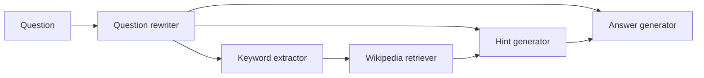

# Optimization quality audit

Audited source: `250eb0b88f9ec2542bdd52e0f27d1e97bd474516` (2026-11-10).
Reported symptom: HotpotQA, approximately 0.42, using the ordinary launcher and
base configuration on another machine. That machine's resolved configuration,
run history, model deployments and predictions were unavailable.

## Assessment

There are substantial, identifiable weaknesses in the current optimization
protocol. The strongest explanations are too little useful search within the
budget, a tiny repeatedly consulted validation sample, noisy preference labels,
and weak feedback for proposing changes. There is no evidence that 0.42 is a
mathematical ceiling of the method. Nor does this audit establish that CAISO can
outperform Optimas: that requires a controlled experiment.

The relevant score is mean answer-token F1, not the fraction of questions answered
correctly. A test F1 of 0.42 and a validation F1 of 0.42 have different meanings.
The current launcher also evaluates the test set only once after optimization.

No production optimizer, benchmark, prompt, metric or default was changed for
this audit. The accompanying probe script and its saved output make the control
flow findings reproducible.

## What actually runs

The command `./scripts/caiso optimize hotpotqa` resolves this path:

```text
scripts/caiso -> scripts/caiso_cli.py -> scripts/optimize_system.py
  -> caiso.optim.optimizer.CaisoOptimizer
  -> caiso.method.algorithm.Algorithm
```

It loads `configs/experiments/hotpotqa.yaml`, merges
`configs/method/default.yaml`, constructs the original HotpotQA system, and
adapts its examples to CAISO records. It does **not** use the learned Optimas
reward model, Optimas component optimizer, reward training, or PPO code retained
elsewhere in this checkout.

The benchmark is four GPT-4o-mini prompt components at temperature 0.6 and one
ColBERT retriever, initially `k=1`, with search choices `{1, 5, 10, 25}`:



Initialization makes two ordinary system runs for each of 50 training questions,
labels their preference, induces a DICAI system constitution, and measures the
initial validation score. Every iteration then:

1. Measures all six edge-ablation effects using validation examples.
2. Partitions the graph with Leiden, with at most two components per block.
3. Asks an LLM to choose a block from diagnostic trajectories and history.
4. Generates three new instructions per prompt component in that block.
5. Scores complete candidate systems on 20 training questions.
6. Selects one changed candidate and compares it with the current system on
   the fixed validation sample.
7. Saves accepted/current/best states and resource use.

Two important qualifications: block constitution induction is disabled, and
candidate ranking uses **task F1 only** (`constitution_weight: 0.0`). The system
constitution guides proposals and scheduling; it is not the numeric candidate
reward. Workflow search is disabled and explicitly rejected by the benchmark
configuration loader. Normal accepted block changes do not refresh the system
constitution. The exported final system is the saved best validation state.

Sources: [launcher](../scripts/optimize_system.py),
[integration optimizer](../caiso/optim/optimizer.py),
[orchestrator](../caiso/method/algorithm.py),
[benchmark factory](../examples/systems/hotpotqa/five_components.py),
[joint search](../caiso/optimizers/joint_block_optimizer.py).

## Findings, in priority order

### 1. Ten examples drive validation, attribution and block selection

**Confirmed; high impact.** The released loader supplies 250 validation
questions. The active profile sets `validation_sampling: first` and
`validation_batch_size: 10`. `CaisoOptimizer.__init__` truncates the validation
pool to those ten **before** passing it to the algorithm. Thus attribution's
configured batch of 20 and diagnostics' configured batch of 20 both use only
ten questions. Changing their batch sizes alone cannot expand the pool.

The same ten questions inform edge weights, the selected block, every acceptance
decision, and best-state selection. This is adaptive reuse of a very small
selection set. It is not test leakage, but it makes overfitting and unstable
selection plausible. An average improvement of 0.05 can be caused by improving
one question by 0.5 F1. The acceptance epsilon of `0.000001` is a numerical
threshold, not evidence that an improvement is statistically reliable.

**Improve:** retain the full validation pool, draw a fixed representative
acceptance sample of at least 50 questions for a diagnostic run, and verify
finalists on a larger independent selection set. For a redesigned protocol,
use training examples for attribution/diagnosis, a separate development set for
acceptance, and reserve the test set for the final comparison. Merely setting
`seeded` does not create those disjoint roles: that requires an explicit split.
More validation costs more runs, so combine this with the efficiency changes
below rather than expecting it to be free.

Evidence: [pool truncation](../caiso/optim/optimizer.py#L51),
[fixed acceptance sampling](../caiso/method/algorithm.py#L43),
[experiment defaults](../configs/experiments/hotpotqa.yaml).
The offline probe confirms a 250-question input becoming a ten-question pool.

### 2. The budget permits roughly 4–9 complete iterations, not 100

**Confirmed control flow; actual remote iteration count unknown.** The profile
requests 100 iterations but the shared run budget is 2,000 equivalent full-system
runs. With distinct proposals and no failures, the measured costs are:

| Stage | One prompt or retriever alone | Two prompts or prompt + retriever |
| --- | ---: | ---: |
| Six edge interventions + shared normal runs | 70 | 70 |
| Block-selection diagnostic trajectories | 10 | 10 |
| Training references and candidate scoring | 100 | 340 |
| Current/candidate validation | 20 | 20 |
| **Total per complete iteration** | **200** | **440** |

Bootstrap execution and initial validation use another 110 runs. That leaves
room for nine single-component iterations or four two-component iterations,
plus part of another iteration. Duplicated proposals can reduce this cost;
errors, retries, larger settings or wall-clock limits can change the outcome.
These figures are offline execution counts, not simulated benchmark accuracy.

Why 340? Each prompt has four options including its current instruction. A pair
has 16 complete configurations, each scored on 20 questions: 320 runs. Obtaining
the initial training reference trajectories costs another 20. Feedback scores
for identical complete states are already reused within a proposal call.

Several avoidable costs remain:

- Every iteration recomputes all attributions, including after rejected changes.
- Attribution's cached normal trajectories are discarded before diagnostics,
  although the default examples and seeds coincide.
- Training reference execution does not populate the score cache for the
  unchanged candidate, causing another baseline evaluation.
- Every candidate is run from the first component, even when only the answer
  generator changes. Edge interventions also rerun all upstream components.

**Improve:** reuse recorded baseline trajectories explicitly; replay unchanged
prefixes and recompute the affected descendants; retain/accumulate attribution
evidence for unchanged states; screen candidates cheaply before spending full
training and validation batches; reserve budget for a complete acceptance gate.
Cached stochastic observations must be identified as reused observations, not
counted as independent repeats. Budget against accepted improvement per unit
cost, not the requested iteration count.

The current `max_joint_candidates: 16` already covers the entire default
two-component HotpotQA menu. Raising it cannot help that menu. Increasing prompt
candidates or lifting the block-size cap expands the product and increases cost;
it is not the first repair to make.

Evidence: [iteration phases](../caiso/method/algorithm.py#L386),
[proposal references and memo](../caiso/optimizers/joint_block_optimizer.py#L139),
[full-system execution](../caiso/integration/runtime.py#L204),
[budget](../caiso/core/budget.py),
[measured counts](optimization_audit_probes.json).

### 3. The bootstrap invents preferences when task scores tie

**Confirmed; serious supervision defect for a task-metric objective.** With
`initial_preference_attempts: -1`, equal rewards get a seeded random A/B winner.
The DICAI prompts then ask for the decisive reusable reason explaining that
winner. There is no equal-preference label and no check excluding identical
label-free trajectories.

Two wrong answers often both score zero; two correct answers can both score one.
Neither case establishes that one is better for the optimized metric. The offline
probe produces 50 identical label-free pairs, and all 50 are still accepted with
`label_source: random_task_tie`. This demonstrates the failure mode; it does not
estimate how many pairs tied in the remote run.

**Improve:** exclude identical pairs, retain ties as ties or skip them, collect
additional distinct variants, and require a meaningful reward margin or repeated
evidence for a strict preference. Deliberately vary candidate instructions and
retriever settings in the bootstrap instead of relying only on incidental
generation randomness. Report useful, tied, filtered and ambiguous pair counts.
The existing positive-attempt mode skips exact reward ties and offers a
configuration-only diagnostic, though it does not implement the fuller repair.

Evidence: [tie labels](../caiso/method/algorithm.py#L102),
[induction request](../caiso/prompts/dicai/reasoning/cot.txt),
[probe](optimization_audit_probes.json).

### 4. Recorded seeds do not pair the actual model generations

**Confirmed.** `UpstreamRuntime.execute` deliberately retains unseeded benchmark
calls and records `task_generation_seeded: False`. The HotpotQA DSPy adapter
disables caching and calls temperature-0.6 models. Reusing the integer seed 42
does not make current/candidate or normal/intervention executions use the same
random draws.

An intervention run regenerates upstream outputs as well as downstream outputs.
Consequently its difference from the normal trajectory can contain upstream and
downstream sampling variation in addition to the ablated edge's effect. With
`stochastic_repeats: 1`, ten questions provide little protection against this.
The estimator computes confidence intervals, but partitioning uses point
estimates without their intervals.

There is a second, narrower forwarding bug: `MethodProvider.complete` accepts a
seed and arbitrary request options but forwards neither the seed nor schema-free
`response_format` to `get_llm_output`. The probe verifies both omissions. The
schema-free JSON format is requested by constitution reconstruction; parsing and
format retries still run, but its requested wire-level format is lost.

**Improve:** distinguish sampling seeds from model-generation seeds in artifacts;
forward supported generation settings and verify the actual requests; use
recorded upstream prefixes for interventions; repeat downstream comparisons and
measure no-intervention noise. API seeds, when available, still do not establish
perfect determinism. Use repeated paired example-level differences and an
independent finalist comparison. Reevaluate the initial, current and leading
saved systems under the same final selection protocol, rather than treating the
largest historical noisy score as a permanently reliable champion.

Evidence: [runtime](../caiso/integration/runtime.py#L204),
[DSPy calls](../caiso/adapt/dspy.py#L62),
[method forwarding](../caiso/integration/services.py#L22),
[edge estimator](../caiso/attribution/estimator.py),
[acceptance](../caiso/method/block_optimization.py).

### 5. Retriever blocks can randomly discard their highest-scoring proposal

**Confirmed; an exploration tradeoff with poor exploitation at the defaults.**
Any block containing a hyperparameter/model selector uses softmax sampling to
choose its complete joint candidate. HotpotQA's retriever is a hyperparameter,
so this applies to its entire block, including any accompanying prompt.
`sample_discrete` defaults to true and the temperature is 0.5 on scores between
zero and one.

For scores `[0.42, 0.45, 0.48, 0.50]`, the best proposal is selected with probability
**26.90%**. All four have already been evaluated, but only the sampled candidate
receives acceptance validation. This is different from sampling a configuration
because it has not yet been evaluated and has an uncertain value.

**Improve:** start with `sample_discrete: false` as an ablation. If exploration is
beneficial, allocate it explicitly using uncertainty and measured improvement
per cost, with a cooling schedule or occasional exploration budget. Validate
more than one finalist only when that fits the budget and selection protocol.

Evidence: [joint selection](../caiso/optimizers/joint_block_optimizer.py#L253),
[softmax implementation](../caiso/optimizers/model_selector.py).

### 6. Prompt generation has weak error feedback and forgets previous calls

**Confirmed.** The proposer sees the current instruction, constitution, original
question, and that component's recorded input/output. It does not receive the
training target, final answer/F1 of those examples as explicit feedback, or the
rest of their downstream executions. The current instruction's score is also
absent from the initial prompt-score history.

New candidate scores are aggregate training F1 and arrive only after each
proposal. History starts empty for every `propose()` call. The probe observes
history lengths `[0, 1, 2, 0, 1, 2]` over two calls. The block-selection history
setting does not change this. Logs retain previous attempts, but the prompt
generator is not given that archive.

**Improve:** supply a bounded set of training failures with reference answers,
final predictions, F1, relevant retrieved evidence and component behavior; ask
for a specific causal hypothesis and a change that addresses it. Gold answers
belong in optimizer feedback, not in the benchmark's inference inputs. Preserve
the component interface. Keep a prompt archive keyed by component and system
context; reevaluate promising old candidates on a common batch before comparing
scores obtained on different questions. Retain within-block joint exploration
for changes that may cooperate despite weak individual feedback.

For HotpotQA, useful failure categories include changed entities/constraints in
rewriting, a keyword query missing a required relation, absent bridge evidence,
hints unsupported by passages, and overly long or incorrectly formatted final
answers. Diagnose which category dominates before changing its prompt.

Evidence: [prompt proposer](../caiso/optimizers/prompt_optimizer.py#L18),
[complete request](../caiso/prompts/method/prompt_optimizer/prompt.txt),
[selection-only history](../caiso/method/optimization_history.py).

### 7. Edge importance is not a measurement of optimization interaction

**Methodological limitation.** The weight is a reward drop after replacing one
delivered value with a baseline. This measures dependence on the supplied
information relative to that baseline. It does not establish that jointly
changing the source and target configurations is better than changing either
alone, nor how much improvement remains possible.

For example, `I(i,j) = R(change_i,change_j) - R(change_i,current_j)
- R(current_i,change_j) + R(current_i,current_j)` measures an interaction of
specific configuration changes. That is a different quantity from blanking a
dataflow edge. Important information can already be handled well; a low-ablation
edge can connect components with useful complementary changes.

The hard partition and two-component cap also mean the question rewriter cannot
be jointly optimized with all its consumers in one proposal. Graph point
estimates and a fixed resolution can cause noisy groupings. The block-selection
LLM sees reward and trajectories but no explicit reference answer, so an eloquent
failure explanation is not necessarily a good estimate of improvability.

**Improve:** compare against round-robin singleton optimization and fixed/overlapping
pair search. Use a small number of measured interaction probes where joint gains
seem plausible, and schedule by improvement per cost with coverage/cooldown for
neglected blocks. Retain attribution only if its additional cost improves the
equal-budget outcome. Larger communities alone are not a justified remedy.

Evidence: [edge effect](../caiso/attribution/estimator.py),
[partition](../caiso/blocks/leiden.py),
[vote scheduler](../caiso/method/block_selection.py),
[selection request](../caiso/prompts/method/block_selection/prompt.txt).

### 8. Constitution quality is neither held-out alignment nor continually adapted

**Confirmed design limitation; impact needs measurement.** Reconstruction applies
the constitution back to the preference pairs that generated it. Those labels
also guide debate and reconstruction-driven revisions. Accuracy on those pairs
does not establish that the constitution predicts F1 improvements for new
questions, new configurations, or individual component outputs. No held-out
alignment threshold gates its use. The final report can contain low reconstruction
accuracy without stopping optimization. Component-ID coverage and one-quality
checks enforce form and coverage, not task-reward alignment.

The base run induces the constitution from initial-system generations and keeps
it through ordinary accepted changes. Block induction is off; workflow-based
refresh cannot run under this integration. A larger or more elaborate constitution
therefore does not necessarily improve the search.

**Improve:** evaluate ranking accuracy on held-out, unequal-task-score pairs,
broken down by component and system context. Compare constitution-guided versus
unguided proposals/scheduling. Refresh after measured distribution or alignment
drift, using newly observed training evidence. Keep the direct task-score gate
while any local critic remains unvalidated. Enabling block induction immediately
would add substantial cost before demonstrating this benefit.

Evidence: [DICAI pipeline](../caiso/constitution/dicai/pipeline.py),
[reconstruction](../caiso/constitution/dicai/reconstruction.py),
[normal block updates](../caiso/method/algorithm.py#L700).

### 9. Measurement and throughput settings can obscure the result

**Confirmed settings; remote service quality unknown.**

- `optimization.num_repeat` is one. Automatic post-optimization testing reads
  that setting, while the separate evaluation command reads
  `evaluation.num_repeat: 3`. A simple optimize command's 0.42 can therefore be
  one stochastic test trial.
- The final answer depends on hints and the rewritten question; it does not
  directly receive all retrieved passages. There is one retrieval stage. These
  inherited interfaces constrain what prompt/k optimization can achieve.
- The answer-token F1 scorer penalizes verbosity and requires an exact normalized
  yes/no response for yes/no gold answers. More explanatory output can reduce F1.
- Optimization executions are serialized by a runtime lock. Raising execution
  workers does not parallelize those full-system calls; independent DICAI requests
  can overlap. Removing the lock without isolating mutable state would break
  candidate isolation.
- Equivalent runs count equal component execution units, while default overhead
  cost is zero. DICAI method requests, training and token cost must also be
  compared. Task-model HTTP retries/tokens are not fully represented in method
  model-call counters. Initial DICAI induction alone performs about 1,000 method
  requests in a successful one-round-per-pair case, before additional revisions.

**Improve:** record per-example predictions/F1 and state fingerprints for baseline
and finalist; report repeated evaluation and variation across independent
optimization runs separately. Check retrieval relevance and model deployment
identity on training diagnostics. Measure real requests, tokens, cost and time.
Treat iterative retrieval, model changes, added evidence inputs or reranking as
a separate expanded-system experiment, since they change the benchmark system.

Evidence: [automatic test](../scripts/optimize_system.py#L102),
[standalone evaluation](../scripts/eval_system.py),
[scorer](../examples/metrics/f1_score.py),
[runtime lock](../caiso/integration/runtime.py),
[accounting](../caiso/core/budget.py),
[reasoning calls](../caiso/constitution/dicai/reasoning_assembly.py).

## Comparison with Optimas

The Optimas paper's Table 2 reports HotpotQA F1 of 0.5048, versus 0.3380
unoptimized and 0.4490 for DSPy; Table 3 reports approximately 2,020 equivalent
system runs. Its Appendix C describes 1,000 training questions, whereas this
released loader defaults to 5,000. These are published reference results, not
a reproduction on the user's backend.
[Source: Optimas paper](https://arxiv.org/html/2507.03041v4).

| Property | Current CAISO integration | Optimas approach |
| --- | --- | --- |
| Candidate reward | Full-system training F1 by default | Learned component reward aligned using downstream outcomes |
| Credit and scheduling | Edge ablations + constitution/LLM votes | Component-specific preference evidence and reward adaptation |
| Joint changes | Explicit complete combinations within a discovered block | Component updates using local reward functions |
| Local model training | Constitution-labelled DPO, when applicable | Reward-guided PPO in the retained implementation |
| Main strength | Can directly test cooperative changes without trusting a local surrogate | Reuses a learned local scoring signal for cheaper search |
| Main risk | Expensive, noisy global evaluations and weak scheduling evidence | Surrogate error, adaptation drift and training cost |

The implementation comparison is supported by the
[pinned Optimas optimizer](https://github.com/snap-stanford/optimas/blob/71871a2dd98081231d733debd41178ba47e13528/optimas/optim/optimizer.py)
and this checkout's [component optimizer](../caiso/optim/cp_optimizer.py) and
[reward-data collection](../caiso/collect/rollouts.py).

CAISO can have an advantage when two changes help together but neither helps
alone. For illustration, rewards could be 0.42 for the current pair, 0.35 and
0.34 for the separate changes, and 0.60 for both together. A greedy coordinate
search may reject the individual changes; a correctly grouped joint search can
find the cooperative improvement. These numbers are illustrative, not results.
The current search correctly retains individually weak options and evaluates
all 16 default pair combinations when proposals are distinct and budget remains.

However, it must discover useful pairs and test enough of them to offset its
overhead. There is currently no evidence that it does this more efficiently than
simple pair search. An interpretable constitution is not a substitute for
measured local/global reward alignment.

Neither method has unconditional global-optimality guarantees for this arbitrary
stochastic prompt-search problem. Optimas's theoretical guarantees have
additional assumptions; they cannot be transferred to CAISO's natural-language
rules. [Source: Optimas theory discussion](https://arxiv.org/html/2507.03041v4).

A promising hybrid would use constitutions to propose/explain changes, a
validated task-aligned local critic to screen them, explicit joint search for
measured interactions, and a reliable global acceptance gate. Whether the critic
and attribution machinery pay for themselves should be an experimental result.

## Improvement order and experiments

1. **Establish the measurement.** Inspect the remote run's actual configuration,
   stop reason, complete iteration count, bootstrap tie fraction and acceptance
   history. Evaluate the initial and frozen best state with the same backend and
   three test repetitions, after selection is finished. Do not use repeated test
   inspection to choose new configurations.
2. **Repair evidence and selection.** Remove fabricated strict tie labels;
   test deterministic discrete selection; give prompt generation explicit
   training-error feedback and a comparable archive; improve validation coverage
   and stochastic comparison. Fix request-option forwarding with provider tests.
3. **Recover the search budget.** Reuse baseline evidence and prefixes, screen
   candidates in stages, and avoid discarding attribution measurements for
   unchanged states. Preserve budget for acceptance and finalist selection.
4. **Require each method component to earn its cost.** Under matched system-run
   budgets compare: unoptimized; simple round-robin direct-F1 optimization;
   fixed/overlapping pair search; repaired CAISO; and upstream Optimas. Then
   separately ablate the constitution, attribution and block induction. Keep
   candidate counts and validation protocol controlled where the comparison
   allows, and report model/training overhead separately.
5. **Test the joint-search claim.** Measure interaction gains and how often
   CAISO discovers useful pairs. Repeat optimization across at least five
   controlled sampling seeds, freeze the selection protocol, and report means,
   variability and paired example-level uncertainty rather than the best run.

Useful existing configuration switches for diagnostic runs:

```yaml
method:
  validation_sampling: seeded
  validation_batch_size: 50
  initial_preference_attempts: 200  # Positive mode skips exact task-score ties.
  initial_preference_pairs: 30
  block_optimization:
    sample_discrete: false
```

These are proposed diagnostic settings, not a proven high-score configuration.
They require a new run. They change both bootstrap and evaluation costs, and do
not implement independent validation roles, prefix replay, noise-aware
acceptance, persistent prompt feedback or held-out constitution calibration.
Keep the 2,000-run cap for an equal-budget ablation, and expect the larger
acceptance batch to reduce the number of iterations until search is made cheaper.

## How to diagnose the run on the other machine

The artifact inspector makes no requests, loads no models, and uses only the
Python standard library:

```sh
python -m scripts.audit_optimization --run results/YOUR_RUN --output audit.json
```

It reports the saved stop reason and budgets; validation settings; bootstrap
label sources; selected component groups; training and acceptance scores; and
available baseline/current/best evaluation reports. It supports the current
separate phase-file layout; missing artifacts are reported as missing values.
It does not recreate missing measurements or inspect secrets.

After the final state has been selected, the matching evaluation commands are:

```sh
./scripts/caiso evaluate results/YOUR_RUN --unoptimized --repeats 3
./scripts/caiso evaluate results/YOUR_RUN --state best --repeats 3
```

For the highest-value manual checks, inspect `run.json`, `history.csv`,
`setup/bootstrap_comparisons.jsonl`, each iteration's `summary.json`,
`03_selection/block_selection.json`, and `05_block_optimization/` acceptance and
validation artifacts. If current and best differ, compare their frozen states on
development data under the same protocol before drawing conclusions about which
is better.

## Repository coverage and verification

| Code family | Role and audit scope |
| --- | --- |
| `scripts/`, `configs/`, `caiso/integration/` | Entry points, resolved settings, state export, service routing, benchmark bridge, snapshot/manual evaluation and manifests |
| `caiso/method/`, `optimizers/`, `attribution/`, `blocks/` | Active orchestration, scheduling, scoring, candidate generation, DPO path, edge effects and partitioning |
| `caiso/constitution/`, `prompts/`, `third_party/democratic_icai/` | Preference projection, three reasoning strategies, debate, atomicity, clustering, abstraction, reconstruction, coverage and request caches; adapted/source prompt parity |
| `caiso/core/`, `arch/`, `adapt/` | State and graph contracts, execution, mutations, locks, trajectories, serialization, recovery, budgets and benchmark adapters; DSPy is the active HotpotQA adapter |
| `caiso/providers/`, `azure_env.py`, `utils/api.py` | Method options, JSON validation, embeddings, deployment mapping, rate limits, retries and request accounting |
| `caiso/eval.py`, `evaluation/`, `scripts/results_layout.py` | Task aggregation, coverage, progress, history, phase artifacts, result layout, checkpoint evaluation and reporting |
| `examples/` | All five benchmark systems, loaders and metrics; HotpotQA execution reviewed end to end; STaRK's extended tool library is retained support code |
| `caiso/optim/` except the replacement optimizer, `collect/`, `reward_*`, `train/`, legacy training scripts | Retained Optimas local reward/PPO/OPRO and collection machinery; not invoked by the active CAISO optimization path |
| `caiso/workflow_search/` and `method/joint_workflow_block.py` | Structural operations, validation and compatibility adaptation; unavailable under the benchmark-parity integration |
| `tests/`, provenance scripts, packaging, figures/docs | Integration and preservation checks, offline algorithm fixtures, configuration and prompt contracts; figures/docs do not affect reward |

Additional non-HotpotQA findings: PubMedQA's retained substring answer parser can
read “no” inside “Knowledge”; initial model-selector edge interventions equal the
initial selected model and therefore cannot reveal alternative-model value.
Amazon DPO labels locally sampled outputs with the constitution rather than
downstream task outcomes. Its GPU training quality was not established here.
The retained STaRK loader also has cold-cache defects (`kb`/`emb_model` undefined
and inconsistent candidate-dictionary shapes between generation and cache
loading); these do not execute on the HotpotQA path. Those benchmark-source
issues require separate fixes if those benchmarks are to be run.

Validation performed:

- `pytest -q`: **424 passed**, three dependency warnings.
- `python -m scripts.verify_upstream`: **107 protected files verified**.
- `python -m scripts.verify_prompts`: **68 prompt files verified**.
- `python -m scripts.audit_optimization`: all offline assertions passed, with
  network connections guarded and deterministic benchmark responses.
- Ruff on the added audit utility passed.

The saved [probe output](optimization_audit_probes.json) contains execution counts
and demonstrated behaviors. The tests and probes do not establish live retrieval
quality, real model performance, the remote run's tie rate, historical Optimas
reproduction, GPU training, or a corrected HotpotQA F1. Those remain empirical
questions. The current source already has useful safeguards: separate test data,
transactional candidate restoration, complete joint scoring, explicit failure
handling and zero-inclusive content-filter coverage. They should be preserved
while repairing the optimization protocol.
